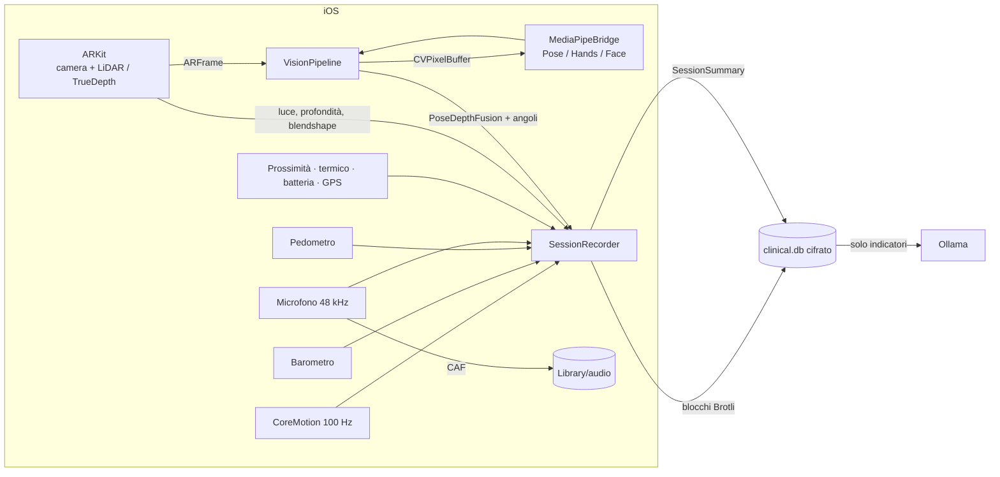

# Clinical Sensor Fusion — architettura e build

Ricostruzione dell'app a partire da [funzionalita-ricostruite.md](funzionalita-ricostruite.md).
App iOS in **.NET MAUI 11** che fonde **MediaPipe** (Google) con **tutti i sensori dell'iPhone**, LiDAR compreso.

## 1. Corrispondenza con l'app originale

| Fatto accertato (doc) | Implementazione |
|---|---|
| .NET MAUI 11, CoreCLR, ReadyToRun | `net11.0-ios`, `UseMonoRuntime=false`, `PublishReadyToRun` in Release |
| Eseguibile `ClinicalSensorFusion` | `AssemblyName` nel `.csproj`; l'app ricostruita si chiama **SensorFusion Clinic** con id `com.lucaguelfi.sensorfusionclinic` (diverso dall'originale `com.lucaguelfi.clinicalsensorfusion`, vedi §8) |
| Audio in `Library/audio/<id>/audio.caf`, mono 48 kHz Float32 | `AudioCaptureSource` (AVAudioEngine, modalità *measurement*) |
| `Library/clinical.db` interamente cifrato, chiave nel Portachiavi | SQLite3 Multiple Ciphers in formato SQLCipher 4 + `KeychainKeyProvider` |
| `Documents` vuota | nessuna esportazione su file; `UIFileSharingEnabled=false` |
| Impostazioni `ollama.server/model/language`, `operator.id/name` | `SettingsKeys` (stessi nomi), `MauiAppSettings` |
| `GET /api/tags`, modello `gemma4:e4b-mlx`, lingua `Italiano` | `OllamaClient`, valori di default |
| WebView + cookie Cloudflare Access | `RemoteAccessPage` + `IosWebSessionBridge` (cookie → HttpClient); in più service token |
| Metal usato direttamente | `ArPreviewRenderer`: camera YCbCr→RGB e mappa LiDAR in shader |
| Testo libero IT/EN | note, domande al modello, lingua della risposta |

Le parti **non** recuperabili dal telefono (schermate, schema DB, prompt) sono state progettate da zero.

## 2. Struttura

```
src/
  ClinicalSensorFusion.Core/        net11.0 — nessuna dipendenza da iOS, testato
    Domain/       sessione, audio, analisi, riepilogo, report leggibile
    Sensors/      SensorKind (layout dei flussi), ISensorSource/ISensorSink, SensorClock
    Fusion/       MediaPipe + LiDAR → punti 3D metrici, angoli articolari
    Signal/       FFT, tremore (Welch), indicatori audio
    Recording/    SessionRecorder (canale non bloccante → blocchi Brotli), metriche live
    Persistence/  ClinicalDatabase (cifrato), migrazioni, ClinicalRepository, audit log
    Ai/           OllamaClient (tags, chat in streaming), ClinicalPromptBuilder
  ClinicalSensorFusion.MediaPipe/   binding .NET del bridge nativo
  ClinicalSensorFusion.App/         MAUI (MVVM Toolkit, binding XAML compilati)
    Platforms/iOS/Sensors/    CoreMotion, barometro, pedometro, GPS, prossimità, stato, microfono
    Platforms/iOS/Vision/     ARKit (camera, LiDAR, TrueDepth), pipeline MediaPipe
    Platforms/iOS/Rendering/  anteprima Metal + handler MAUI
native/MediaPipeBridge/             Swift: facciata Objective-C su MediaPipe Tasks Vision
tests/ClinicalSensorFusion.Core.Tests/  xUnit v3
```



## 3. Sensori

| Sensore | API iOS | Frequenza | Flusso |
|---|---|---|---|
| Fotocamera posteriore + **LiDAR** | ARKit `sceneDepth` (256×192, confidenza) | 60 fps (inferenza ~20–30 fps) | `PoseLandmarks2D/3D`, `JointAngles`, `HandLandmarks`, `LidarDepth` |
| Fotocamera **TrueDepth** | ARKit face tracking | 60 fps | `FaceBlendshapes` (52 coefficienti) |
| Accelerometro, giroscopio, magnetometro | `CMDeviceMotion` | 100 Hz | `Motion` |
| Barometro | `CMAltimeter` | ~1 Hz | `Barometer` |
| Coprocessore di movimento | `CMPedometer` | a eventi | `Pedometer` |
| Microfono | `AVAudioEngine` (measurement) | 48 kHz | file CAF + `AudioLevel` |
| Luce ambientale (stima) | `ARLightEstimate` | 2 Hz | `AmbientLight` |
| Prossimità | `UIDevice` | a eventi | `Proximity` |
| GPS (opzionale, spento di default) | `CLLocationManager` | ~1 Hz | `Location` |
| Stato termico, batteria | `NSProcessInfo`, `UIDevice` | 0,2 Hz | `DeviceState` |

Non usati: UWB (richiede un secondo dispositivo), Bluetooth (nessuna periferica nota dell'app originale),
sensore di luce ambientale hardware (nessuna API pubblica su iOS).

## 4. Fusione MediaPipe + LiDAR

1. ARKit consegna immagine, mappa di profondità e intrinseci **dello stesso istante**.
2. MediaPipe lavora sull'immagine ruotata dritta (`.right` in verticale): i punti tornano nel sistema del
   sensore con `OrientationMapper`.
3. Per ogni punto visibile si prende la **mediana 5×5** della profondità con confidenza ≥ media
   (ai bordi del corpo l'intorno mescola soggetto e sfondo: la media sbaglierebbe).
4. Retroproiezione pinhole: `X = (u − cx)·Z/fx`, `Y = (v − cy)·Z/fy`.
5. Se meno del 75% dei punti chiave ha profondità valida (soggetto oltre ~5 m, controluce),
   si usano i *world landmarks* di MediaPipe e il dato è marcato come "stima 3D".
6. Gli angoli sono calcolati in 3D (invarianti alla prospettiva) con convenzioni goniometriche.

Limiti noti: il LiDAR misura la superficie (pelle/abiti), non il centro articolare; accuratezza attesa degli
angoli ±5–10°. **Non è un dispositivo medico certificato**: per un uso clinico serve una validazione contro
un sistema di riferimento (es. motion capture ottico) e la valutazione regolatoria (MDR).

## 5. Sicurezza e privacy

- DB cifrato per intero (SQLCipher 4, AES-256), chiave casuale a 256 bit nel Portachiavi
  (`AfterFirstUnlockThisDeviceOnly`, non sincronizzata, non nei backup).
- File audio con protezione dati iOS `CompleteUnlessOpen`.
- Soggetti identificati solo da **codice pseudonimo**; ogni sessione e analisi è firmata dall'operatore;
  `audit_log` di creazione/chiusura/eliminazione/analisi.
- Al modello linguistico vanno **solo indicatori numerici** (no codice soggetto, no operatore, no audio/immagini);
  le note sono delimitate per ridurre la prompt injection.
- HTTP in chiaro consentito **solo in rete locale** (`NSAllowsLocalNetworking`); da Internet serve HTTPS
  (Cloudflare Access con login nella WebView o service token salvato nel Portachiavi).
- Manifest privacy `PrivacyInfo.xcprivacy` con le motivazioni delle API sensibili.

## 6. Prerequisiti (Mac)

| Strumento | Versione |
|---|---|
| macOS + Xcode | Xcode 26.x |
| .NET SDK | 11.0 (RC1 o successiva) + `dotnet workload install maui-ios` |
| CocoaPods, XcodeGen | `brew install cocoapods xcodegen` |
| iPhone con LiDAR | iPhone 12 Pro o successivi modelli "Pro" (il dispositivo dell'app originale è un iPhone 12 Pro) |

## 7. Build ed esecuzione

```bash
./scripts/download-models.sh                 # modelli MediaPipe (.task, ~20 MB)
./native/MediaPipeBridge/build.sh            # MediaPipeBridge.xcframework (anche automatico al primo build)
dotnet build src/ClinicalSensorFusion.App -f net11.0-ios -t:Run -p:_DeviceName=<UDID>
```

Test del Core (qualsiasi OS):

```bash
dotnet test --project tests/ClinicalSensorFusion.Core.Tests
# senza SDK .NET 11:  ... -p:CsfNetTfm=net10.0
```

Con un **account Apple gratuito** (come l'originale, team `Y7S9A29635`) l'app scade dopo 7 giorni e va
reinstallata; le entitlement sono vuote proprio per restare compatibili con il profilo gratuito.

## 8. Migrazione dall'app originale — ATTENZIONE

- **Non disinstallare l'app originale** finché i dati non sono stati valutati: disinstallando si perdono le
  33 registrazioni e `clinical.db`.
- L'app ricostruita ha un `ApplicationId` diverso (`com.lucaguelfi.sensorfusionclinic`): si installa **accanto**
  all'originale, senza sovrascriverla, e ha un proprio contenitore e un proprio archivio cifrato.
- La nuova app non vede i dati dell'originale (sandbox iOS) e, anche se li copiasse, non potrebbe decifrare il
  vecchio `clinical.db`: la chiave è nel Portachiavi del vecchio team di firma. In caso di file con chiave diversa
  `ClinicalDatabase` solleva `DatabaseKeyMismatchException` e **non tocca il file**.
- I file CAF sono leggibili da qualunque strumento audio (formato standard) se estratti dal contenitore
  (Xcode → Devices → Download Container, con l'app originale ancora firmata dal suo team).

## 9. Cosa è verificato e cosa no

Verificato in questo repository:
- Core: compilato e **38 test** superati (fusione, orientamento, FFT, tremore per assi con soglia di significatività, audio, cifratura reale del DB
  con chiave errata rifiutata, registratore → DB → riepilogo, client Ollama con streaming, prompt senza identificativi).
- Codice iOS dell'app: controllo dei tipi contro gli assembly di riferimento **iOS 26.1** e MAUI iOS;
  XAML con binding compilati validati dal generatore MAUI.

Da verificare su Mac/iPhone (non eseguibile in un ambiente Linux):
- compilazione del bridge Swift contro il pod `MediaPipeTasksVision` (versione fissata a 0.10.21) e del binding;
- orientamento corretto per la fotocamera **frontale** (`.left` assunto) nella modalità Volto;
- disponibilità del runtime CoreCLR per iOS nella toolchain installata (altrimenti rimuovere `UseMonoRuntime=false`).
