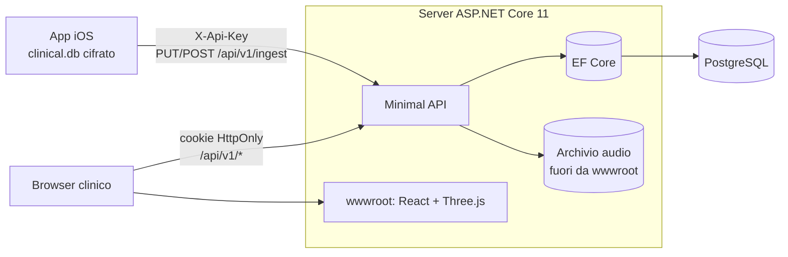

# Server clinico e dashboard 3D

Backend **ASP.NET Core 11** (`src/ClinicalSensorFusion.Server`) con **PostgreSQL**, e dashboard
**React + Three.js** (`src/ClinicalSensorFusion.Dashboard`, React Three Fiber) servita dallo stesso server.

## 1. Cosa fa

| Area | Funzioni |
|---|---|
| Anagrafica pazienti | Codice pseudonimo (lo stesso inserito nell'app), nome, cognome, data di nascita, sesso, codice fiscale, contatti, indirizzo, diagnosi, note. Ricerca, paginazione, modifica con **concorrenza ottimistica**, cancellazione definitiva (diritto all'oblio, anche dei file audio). |
| Ricezione dall'app | Metadati della rilevazione, riepilogo clinico, **tutti i flussi dei sensori** (blocchi compressi identici a quelli del telefono), file **CAF**, analisi IA. Invio idempotente: si può ripetere senza duplicati. Un codice sconosciuto crea un'anagrafica "da completare". |
| Dashboard | Panoramica (KPI, attività settimanale 3D, **galassia dei tremori** 3D, ROM medio 3D, rilevazioni recenti); paziente (**paesaggio 3D dell'escursione articolare** nel tempo, trend, anagrafica); rilevazione (**replay 3D dello scheletro** LiDAR, **spettrogramma 3D** del tremore, indicatori, audio, analisi IA). |

## 2. Architettura



- **Contratto condiviso**: i DTO di sincronizzazione (`Core/Sync`) e il codec dei blocchi sono nel Core, usati
  sia dall'app sia dal server. Il server decodifica i blocchi con lo stesso codice che li ha scritti.
- **Dati pesanti lato server**: replay e spettrogramma sono calcolati e sottocampionati sul server
  (≤ 900 fotogrammi, ≤ 160 colonne); al browser arrivano poche centinaia di KB.
- **Indicatori denormalizzati** (durata, tremore, copertura LiDAR) per le query della panoramica; il riepilogo
  completo è in `jsonb`.

## 3. Sicurezza

| Rischio | Contromisura |
|---|---|
| Furto della chiave del dispositivo | Solo l'hash SHA-256 è in configurazione; la chiave consente **solo** di inviare dati, non di leggerli. Revoca = rimuovere la voce. |
| Credenziali della dashboard | Password PBKDF2 (ASP.NET Core Identity v3); verifica a tempo costante anche per utenti inesistenti; **rate limit** 5 login/minuto per IP. |
| Furto di sessione / CSRF | Cookie `HttpOnly`, `Secure`, `SameSite=Strict`, scadenza 8 h; SPA sulla stessa origine, nessun token in `localStorage`. |
| XSS / clickjacking | CSP `default-src 'self'` (niente CDN), `frame-ancestors 'none'`, `nosniff`, `no-referrer`. |
| Path traversal sui file | Id validati (32 hex) prima di comporre i percorsi; file scritti in modo atomico e verificati come CAF. |
| Tracciabilità | `audit_log` per login, letture e modifiche dell'anagrafica, letture delle rilevazioni, riproduzione audio, ingestione. |

Da fare prima della produzione: TLS sul reverse proxy (es. Cloudflare Tunnel), backup cifrati di PostgreSQL e
dell'archivio audio, cifratura del volume dati, DPIA (GDPR art. 35) per dati sanitari.

## 4. Avvio in sviluppo

```bash
docker compose up -d                                   # PostgreSQL 16 locale, senza password (solo 127.0.0.1)
cd src/ClinicalSensorFusion.Dashboard && npm ci && npm run build && cd -   # dashboard in wwwroot
dotnet run --project src/ClinicalSensorFusion.Server --launch-profile http
```

Con un PostgreSQL già installato che richiede una password, impostarla fuori dal repository:
`dotnet user-secrets set ConnectionStrings:Clinical "Host=localhost;Database=clinical_dev;Username=…;Password=…" --project src/ClinicalSensorFusion.Server`.
Il repository non contiene credenziali del database (anche CI e docker-compose usano l'autenticazione `trust` su istanze effimere/locali).

Apri http://localhost:5180 — utente `demo`, password `clinica2026`. In sviluppo (`appsettings.Development.json`)
il database `clinical_dev` viene popolato con **6 pazienti fittizi** e ~30 rilevazioni sintetiche
(cinematica plausibile di squat, tremori a 4,8 / 7,5 / 9,5 Hz). Per sviluppare la dashboard con hot reload:
`npm run dev` (Vite su http://localhost:5173, inoltra `/api` al server).

Chiave di sviluppo per l'app: `dev-device-key-solo-sviluppo`.

## 5. Produzione

```bash
# Hash della password di un utente della dashboard
dotnet run --project src/ClinicalSensorFusion.Server --no-launch-profile -- hash-password '<password>'
# Nuova chiave per un iPhone (la chiave va inserita nell'app, l'hash nel server)
dotnet run --project src/ClinicalSensorFusion.Server --no-launch-profile -- new-device-key iphone-ambulatorio-1
dotnet publish src/ClinicalSensorFusion.Server -c Release -o out   # compila anche la dashboard (npm)
```

Configurazione (variabili d'ambiente o secret store, mai nel repository):

```
ConnectionStrings__Clinical=Host=…;Database=clinical;Username=…;Password=…
Dashboard__Users__0__UserName=…            Dashboard__Users__0__PasswordHash=…
Ingest__Devices__0__Name=iphone-1           Ingest__Devices__0__KeySha256=…
AudioStorage__Root=/var/lib/clinical/audio
```

Nell'app iOS: Impostazioni → *Server clinico* → indirizzo HTTPS e chiave del dispositivo.

## 6. API

OpenAPI su `/openapi/v1.json` e interfaccia Scalar su `/scalar` (solo in sviluppo). Principali rotte:

| Metodo | Rotta | Autorizzazione |
|---|---|---|
| `PUT` | `/api/v1/ingest/sessions/{id}` | dispositivo |
| `POST` | `/api/v1/ingest/sessions/{id}/chunks` | dispositivo |
| `PUT` | `/api/v1/ingest/sessions/{id}/audio/{audioId}` | dispositivo |
| `POST` | `/api/v1/auth/login` · `logout` · `GET me` | — / clinico |
| `GET/POST/PUT/DELETE` | `/api/v1/patients[/{id}]` | clinico |
| `GET` | `/api/v1/patients/{id}/sessions` · `/trends` | clinico |
| `GET` | `/api/v1/sessions/{id}` · `/pose` · `/spectrogram` · `/streams/{kind}` · `/audio/{audioId}.wav` | clinico |
| `GET` | `/api/v1/dashboard/overview` | clinico |
| `GET` | `/health` | — |

## 7. Verifiche

- **Server: 15 test di integrazione** su PostgreSQL reale. Coprono:
  - autenticazione e autorizzazioni;
  - header di sicurezza;
  - anagrafica CRUD, validazione e concorrenza ottimistica;
  - percorso completo **DB cifrato del telefono → sincronizzatore → API → PostgreSQL → dashboard**, incluso il reinvio idempotente;
  - conversione CAF→WAV, path traversal e dati demo.
- **Core: 38 test.** La sincronizzazione end-to-end ha fatto emergere un errore reale nel calcolo del tremore (il
  modulo dell'accelerazione raddoppiava la frequenza) e la necessità di una soglia di significatività. Entrambi corretti.
- **Dashboard:** typecheck TypeScript strict, test Vitest, build Vite e verifica visiva con Chromium headless
  (WebGL software) di tutte le pagine, senza errori in console.
- **Non verificato qui:** esecuzione su .NET 11 (l'ambiente aveva l'SDK 10; la CI usa .NET 11).
